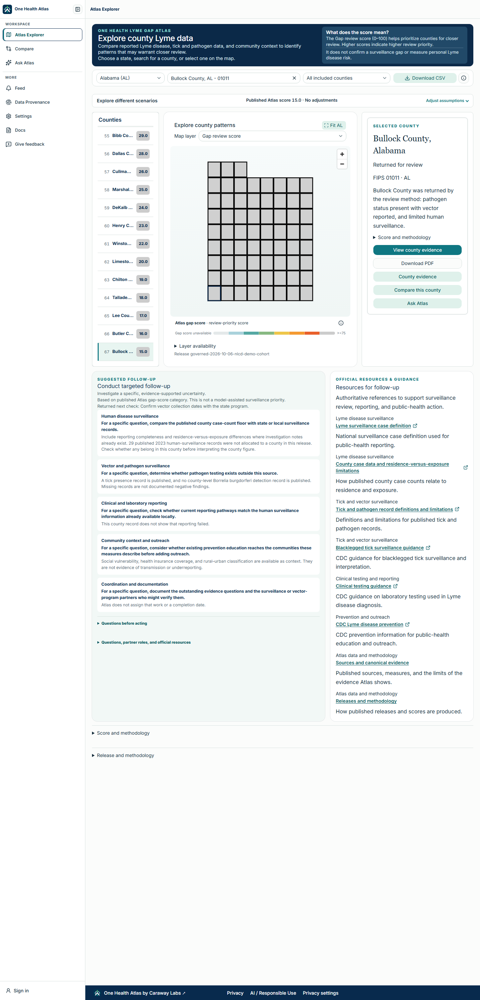
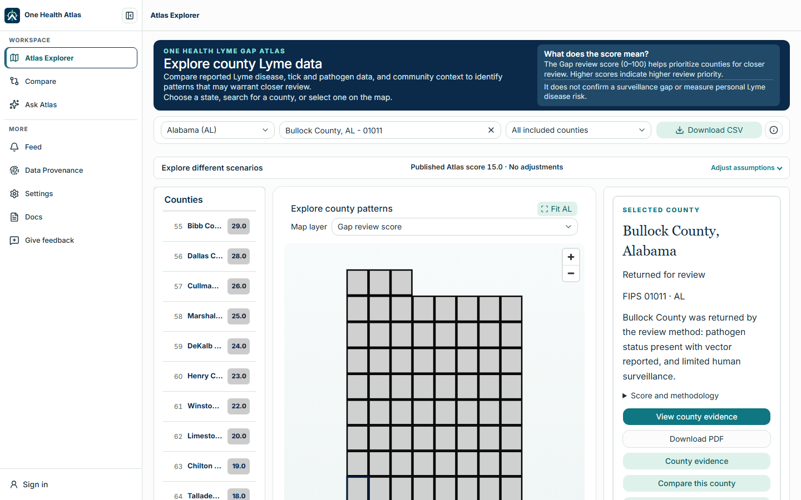
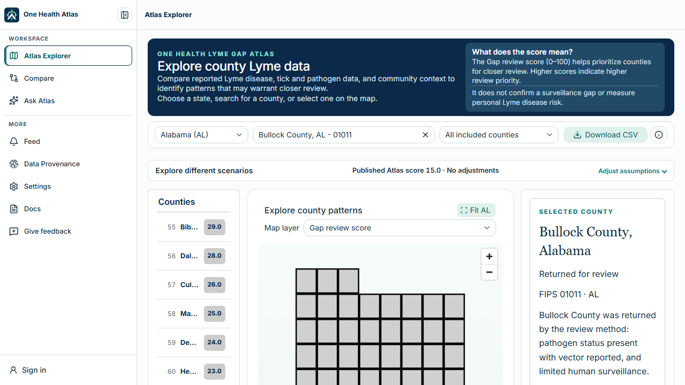
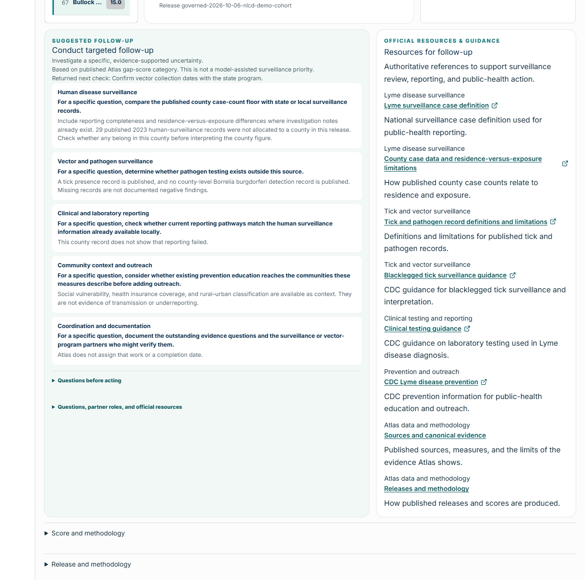
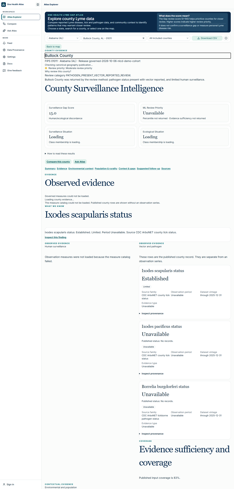
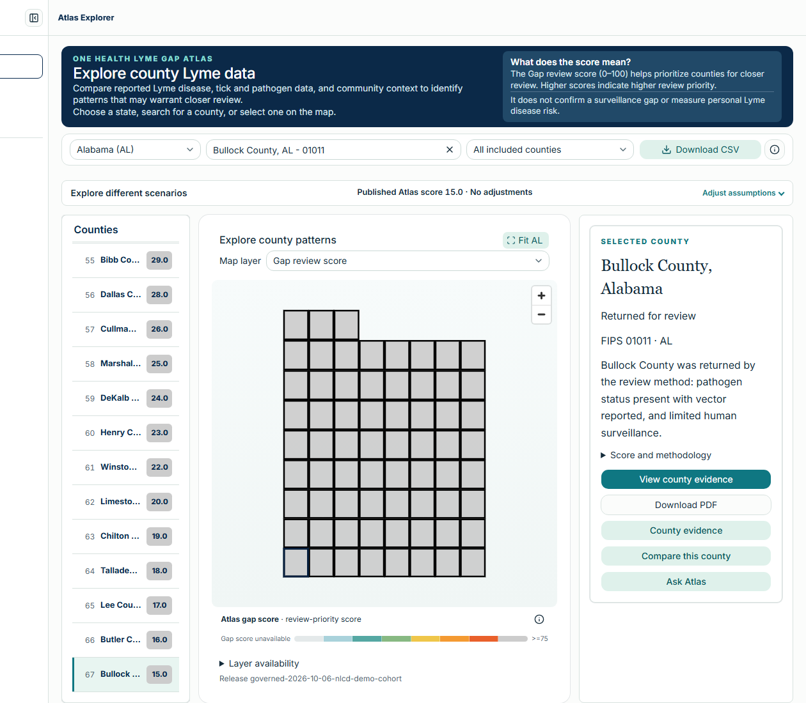
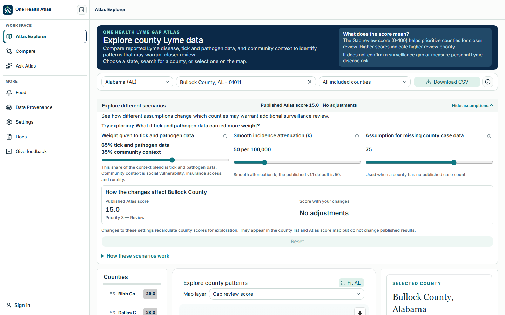
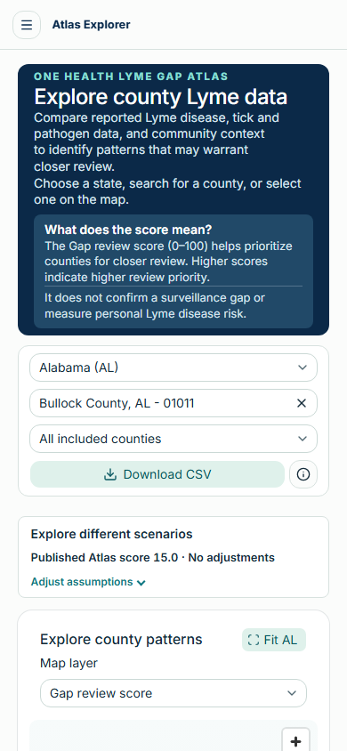

# UX Audit: Atlas Explorer (`/explore`)

**Role:** Senior UX Designer / UX Engineer audit
**Date:** 2026-10-20
**Product:** One Health Lyme Gap Atlas, professional workspace (`one-health-lyme-gap-atlas-web`)
**Target users:** Epidemiologists using Atlas as a decision-support intelligence platform
**Type of work:** Inspection and audit only. **No application code was changed.**
**Target stack for recommendations:** shadcn/ui (primary) · Base UI (interactive primitives) · Lucide React (icons) · Tailwind CSS v4 (styling and tokens)

---

## 0. Executive summary

### Verdict

`/explore` is **scientifically careful but visually under-powered**. The governance work is strong: evidence states, caveats, URL reproducibility, and map/list parity are all taken seriously. But the interface expresses almost all of that care **as sentences**. An epidemiologist arriving at the page has to *read* their way to the answer to the four questions they came with:

1. **Where** should I look?
2. **Why** is this county flagged?
3. **How much** should I trust it (how complete is the evidence)?
4. **What** do I do next?

None of those four questions is answerable at a glance today. Each is answerable by reading a paragraph.

### Measured snapshot (rendered page, 1440×900, Alabama state view)

| Measure | Result |
| --- | --- |
| Visible words on the browse view | **≈ 950** (national view ≈ 600; county-evidence view ≈ 1,075) |
| Of which, prose that is not data (hero, notes, follow-up, resources, helper text) | **≈ 630 words (~65%)** |
| Where the map canvas begins | **~440 px down at 1440×900 (49% of viewport); ~455 px at 1280×720 (63%); off-screen at 390×844** |
| Interactive controls in `<main>` | **~90 buttons, ~30 links, 10 inputs** (state view) |
| Font sizes in use inside `<main>` | **7–10 distinct sizes, from 10.4 px to 16 px** (evidence view adds 24.8 px and 32 px serif headings) |
| Page height | 3,970 px (state view), 4,977 px (county evidence), **7,892 px on a 390 px-wide phone** |
| Static reference text below the fold | Follow-up card (≈235 words) + Official resources card (≈158 words) = **≈40% of the page's text**, shown even when no county is selected |

### The ten moves that matter most

| # | Move | Why it matters |
| --- | --- | --- |
| 1 | **Make the map the hero.** Replace the dark hero banner + toolbar + scenario bar (three stacked bands) with one slim context bar; give the map stage ≥ 65% of the viewport height. | The page job is "map-led review" ([constitution](../UX_RESET_CONSTITUTION.md)), but the map starts halfway down the screen. |
| 2 | **Replace the "Selected county" prose with a County Summary Card**: score on a ramp, evidence-completeness meter, an icon "evidence fingerprint", caveat chips. | Turns "Bullock County was returned by the review method: pathogen status present with vector reported, and limited human surveillance." into something scannable in under two seconds. |
| 3 | **Turn the ranked list into a compact table with in-cell bars** (shadcn `Table`, already installed). | Current rows truncate county names ("Bibb Co…", "Cullma…") and show only a number in a colored pill. |
| 4 | **Collapse the follow-up and official resources cards into checklist cards and a menu.** | ≈390 words of static text become ≈70 words plus a menu. |
| 5 | **Move the scenario ("what-if") controls into a Sheet** with a persistent "Scenario active" Badge on the map/list when engaged. | Frees a prime horizontal band and reduces a likely misread risk (adjusted vs published scores; see C6, to verify on a live adjusted session). |
| 6 | **Compress the 4-field provenance pattern into chips** (source · period · type), keep the single "Inspect provenance" action. | Evidence cards repeat "Unavailable" up to five times per card. |
| 7 | **Introduce a visual grammar for Available / Limited / Unavailable** (icon + label + pattern) used identically on map, list, card, and evidence table. | Makes "missing is not zero" visible rather than only stated. |
| 8 | **Add a Breadcrumb as the single visible representation of geography** (United States › Alabama › Bullock County). | Four overlapping controls set geography today (state select, county search, map drill, list) with no shared state display. |
| 9 | **Fill the missing primitives** (Tabs, ToggleGroup, Collapsible/Accordion, Sheet/Drawer, Breadcrumb, Combobox, Separator, ScrollArea, Meter). Base UI 1.9 (installed) already ships the behavior; shadcn wrappers are missing in `src/components/ui`. | Every recommendation above is buildable with **zero new dependencies**. |
| 10 | **Run a 5–6 user task test with real epidemiologists** before and after. | Everything here is expert inference; Section 9 gives a ready-to-run protocol. |

### What is *not* recommended

- Not recommending new pages, a dashboard, or absorbing Compare/Ask Atlas into Explorer (constitution forbids "mega-page").
- Not recommending a contextual-help system, tours, or "?" widgets (explicitly out of scope for Reset V1).
- Not recommending red/green "risk" coloring, a nationwide county leaderboard, or any change that implies review priority equals disease risk.

---

## 1. Scope, method, and honest limitations

### What was audited

Route `/explore` (**Atlas Explorer**), rendered by `ResetReviewExperience`
(`src/features/ux-reset/review/reset-review-experience.tsx`), including:

- National view (`scope=ALL`)
- State view with and without a selected county (`scope=AL`, `county=…`)
- County evidence in place (`mode=evidence`) and suggested follow-up (`mode=follow-up`)
- The scenario ("Explore different scenarios") panel
- 1440×900, 1280×720, and 390×844 viewports

### How it was audited

1. **Governance first.** Read root `AGENTS.md`, `TECHNOLOGY_AND_GOVERNANCE.md`, the web repo `README.md`/`AGENTS.md`, `docs/UX_RESET_CONSTITUTION.md`, and `docs/DESIGN_SYSTEM.md`.
2. **Code inspection** of the page composition, toolbar, map, legend, ranked list, county preview, follow-up, resources, scenario, and evidence components.
3. **Rendered inspection.** `/explore` requires sign-in. I did not authenticate. Instead I used the repository's own `ATLAS_E2E=1` sign-in bypass (dev/test only; documented in the repo's Playwright setup) in an **isolated, throwaway copy** of the web app outside the repository, with API calls answered by the repository's existing test fixtures. The copy was deleted afterward. The repo working tree is unchanged; the two running dev servers were not touched.
4. **Measurement** of rendered text, controls, font sizes, and layout positions.
5. **Heuristic review** against Nielsen's 10 heuristics, WCAG 2.2 AA intent, data-visualization practice (preattentive attributes, small multiples, color-vision safety), and the Atlas constitution.

### What I could not verify (read these before acting on the findings)

| Limitation | Effect on the audit |
| --- | --- |
| **Fixture data, not live data.** All Alabama counties share one grey fill; the national map geometry was not served by the fixtures. | I could **not** judge the real color ramp on the map, real map legibility, or the real national map. Color findings are from tokens and code, not pixels. |
| **County-evidence measure catalog did not render** in my mock, so the "Observed evidence" tables showed their *error* states. | Findings about the evidence hierarchy come from the code (`InvestigateEvidenceHierarchy`, evidence cards) plus the partial render. Re-verify with live data. |
| **Alabama fixture scores all 67 counties.** | The county list is much longer than a typical bounded list would be. Row design findings still hold; list-length findings are noted as fixture-inflated. |
| **No users, no analytics, no session recordings.** | Persona jobs below are **inferred**, labelled as such, and need validation. |
| **No assistive-technology pass, no contrast measurement.** | Accessibility notes are code-and-visual observations, not a conformance statement. |
| **No performance profiling.** | Not assessed. |

---

## 2. Who this is for, and what they are trying to do (inferred)

> These are working assumptions to validate in Section 9, not research findings.

| Persona | Typical context | Primary question on `/explore` |
| --- | --- | --- |
| **State vector-borne disease epidemiologist** | Planning state surveillance priorities, writing for leadership | "Which counties in my state warrant targeted follow-up this season, and how defensible is that?" |
| **Local health department analyst** | One jurisdiction, limited staff | "Is my county flagged? What evidence is missing, and what can I do about it?" |
| **Regional program / CDC-adjacent lead** | Cross-state patterns | "Where are there evidence gaps relative to ecological signal?" |
| **Researcher / data analyst** | Method scrutiny | "What exactly is this score, what version, can I export it with provenance?" |

### The decision-support loop the page must serve

```
ORIENT  →  TRIAGE  →  EXPLAIN  →  ASSESS CONFIDENCE  →  ACT / COMMUNICATE
(where?)   (which?)   (why?)      (how complete?)        (follow up / export / compare)
```

| Loop step | Today | Gap |
| --- | --- | --- |
| Orient | Hero text + state select + map | Geography shown four ways, none unified |
| Triage | Ranked list (name + score pill) + map color | List truncates names; no visual of how scores are distributed |
| Explain | One sentence of prose + collapsed "Score and methodology" | No visual of *what drives* the score |
| Assess confidence | Words (Limited, Available, "Missing records are not documented negative findings") | No at-a-glance completeness |
| Act / communicate | 5 stacked buttons + two prose cards + CSV that excludes scores | Hierarchy of actions unclear; export loses the score |

---

## 3. Current-state anatomy

Full-page capture, state view with a county selected (1440 wide). The page scrolls inside `<main>`.



```
┌ Workspace sidebar (256px) ┬────────────────────────────────────────────────────────────┐
│                           │ [A] HERO BANNER (navy)  ≈80 words                           │
│                           │     title · 3 sentences · "What does the score mean?" box   │
│                           ├────────────────────────────────────────────────────────────┤
│                           │ [B] TOOLBAR  State ▾ | County search | Data filter ▾ | CSV | ⓘ │
│                           ├────────────────────────────────────────────────────────────┤
│                           │ [C] "Explore different scenarios" bar  (expands to ≈130 words)│
│                           ├──────────┬──────────────────────────┬──────────────────────┤
│                           │ [D] LIST │ [E] MAP CARD             │ [F] SELECTED COUNTY   │
│                           │ 18%      │ header · layer select    │ prose + 5 buttons     │
│                           │ names    │ canvas                   │                       │
│                           │ truncate │ legend · availability    │                       │
│                           │          │ release caption          │                       │
│                           ├──────────┴────────┬─────────────────┴──────────────────────┤
│                           │ [G] SUGGESTED FOLLOW-UP ≈235 words │ [H] OFFICIAL RESOURCES ≈158 words │
│                           ├────────────────────────────────────────────────────────────┤
│                           │ [I] ▸ Score and methodology   [J] ▸ Release and methodology │
└───────────────────────────┴────────────────────────────────────────────────────────────┘
```

Zones A–C (hero, toolbar, scenario bar) sit **above** the map. Zones G–J (prose, reference, disclosures) sit **below** it. The map and its two companions (D, E, F) are sandwiched in the middle, and A–C alone take roughly half the first screen.



### Prose-versus-data inventory (state view, closed scenario panel, approximate)

| Region | Approx. words today | Nature |
| --- | --- | --- |
| A. Hero banner | 80 | Static prose, owner-approved copy |
| B. Toolbar export note (tooltip + screen-reader copy) | 38 | Helper text |
| C. Scenario bar (closed) / (open) | 10 / ≈130 | Prose + control captions |
| E. Map header, layer explanation, legend, availability, release caption | 59 | Mixed |
| D. County list rows (67 rows in this fixture) | 337 | Data (name, rank, score) |
| F. Selected-county preview | 48 | Prose |
| G. Suggested follow-up | 235 | Static prose |
| H. Official resources | 158 | Static reference |

---

## 4. Constraints from governance (what the redesign must respect)

Every recommendation below was checked against these. Items marked **Owner decision** touch a settled or owner-approved item and must not be implemented without explicit sign-off.

| Rule (source) | How this audit respects it |
| --- | --- |
| Evidence vocabulary is **Available / Limited / Unavailable**, from API metadata only (constitution, #409) | All redesigned evidence states keep these three words as the label. Icons/patterns *add* encoding; they never replace the word. |
| **Loading/error are not "Unavailable"** (#426) | Loading uses a neutral spinner, never a value-shaped skeleton (constitution anti-pattern: "skeleton layouts that imply governed evidence"). |
| **Missing is not zero** | Pattern + icon for missing/suppressed; zero keeps a numeric look. |
| **Review priority is not disease risk**; avoid red/green clinical-dashboard cues | The disclaimer is *kept visible* (compact Badge). Ramp change is flagged **Owner decision**. |
| **No general contextual help in Reset V1** (no tours, field-level "?" systems) | No new help system proposed. Accessible names/labels for icon-only buttons are not "help". The existing legend "About" popover is reused rather than expanded. |
| **No default nationwide county leaderboard** | Shortlist stays bounded (current: first 40). Rank-number display is flagged **Owner decision**. |
| **Explorer must not absorb Compare, Ask Atlas, or Feed** | Actions remain hand-offs (links), not embedded workflows. |
| **Ask Atlas is answer-only, user navigates** | Ask Atlas stays a navigation link, not an in-page assistant. |
| **Map/non-map parity** (Governance §4) | A table is a first-class peer of the map, not a fallback. |
| **Provenance layering + one-action inspect** (#409) | Default disclosure keeps source family, period, evidence type, material caveat, then one "Inspect provenance" action. |
| **Hero copy is product-owner copy** (`page-introduction-copy.ts`: "follows the October 19, 2026 design revision") | Condensing the hero is **Owner decision**. |
| **Design system first** (AGENTS.md): use `src/components/ui`, semantic tokens, no second UI framework | Proposed only shadcn/Base UI/Lucide/Tailwind. Adding primitives to `src/components/ui` is the documented path. |

---

## 5. What already works (keep it)

A fair audit credits the strong parts. These should survive any redesign:

- **URL-reproducible state** (scope, county, layer, scenario, dataset, mode). This is excellent for epidemiologists who share findings.
- **Map and list parity.** The ranked list is a real non-map path to the same result.
- **Honest absence handling.** The product refuses to turn missing data into zero, and says why.
- **Atlas will not pick for you.** "Choose a county… Atlas will not pick one." is a principled stance (the *wording* is wordy; the *behavior* is right).
- **Bounded national shortlist**, with an explanation of why it is bounded.
- **Layer system** (10 layers: gap score, incidence floor, tick status, B. burgdorferi, SVI, uninsured, rurality, completeness, boundaries) with a legend whose segments are interactive.
- **Scenario sliders persisted in the URL**, so a what-if analysis is shareable.
- **Fit-to-geography** control and zoom controls on the map.
- **Keyboard-conscious construction** (combobox roles, `aria-current` on the selected row, focus return from evidence to map).

---

## 6. Findings

**Severity scale**

- **S1: Blocks the decision-support job.** Users cannot reliably do the primary task or will likely misread.
- **S2: Significant friction.** Task is possible but slow, effortful, or error-prone.
- **S3: Polish / consistency.**

Each finding lists **Evidence**, **Impact for an epidemiologist**, and **Recommendation** (with the component to use).

---

### Theme A: Information hierarchy and first-viewport

#### A1 · The map is not the hero (S1)

**Evidence.** Hero (A), toolbar (B), and scenario bar (C) stack above the map. The map *canvas* begins ~440 px down at 1440×900 (49% of viewport height), ~455 px down at 1280×720 (63%), and is entirely below the first screen at 390×844.



**Impact.** The page job is "bounded national/state operating picture" and the constitution calls it *map-led*. Today the first thing an expert sees is a navy marketing-style banner and form controls. The visual overview (where are the hot spots?) requires scrolling, defeating the "glance" that makes maps valuable.

**Recommendation.**
- Replace A + B + C with **one slim context bar** (44–56 px): Breadcrumb · State `Select` · county `Combobox` · data filter `ToggleGroup`/`Select` · Scenario button (with active Badge) · Export `DropdownMenu` · Release Badge.
- Make the main stage fill the viewport: `h-[calc(100dvh-var(--header-h)-var(--context-bar-h))]`, with the map taking the remaining width beside a right rail (see Section 7).
- The page already has a global header ("Atlas Explorer"). The in-page headline "Explore county Lyme data" can become a visually-hidden `h1` or live in the context bar; the supporting sentence moves to Docs. *(Owner decision; copy is product-owner approved.)*

#### A2 · Three equal-weight cards with no focal point (S2)

**Evidence.** List (18%), map (52%), and preview (30%) share the same white-card treatment, plus two more cards beneath (G, H), plus two `<details>`. Nothing is visually dominant except the filled "View county evidence" button.

**Impact.** Scan paths are ambiguous; the eye has no entry point and no path. Expert users form a "mental map" faster when one object leads.

**Recommendation.** One **primary object (map)**, one **companion rail** with tabs (Shortlist | County). Cards lose their heavy borders; separate with spacing and `Separator`. Use elevation sparingly: only the map stage and the rail get containers.

#### A3 · Permanent disclaimer takes the best real estate; it should travel with the number instead (S2)

**Evidence.** The "What does the score mean?" box inside the hero explains the 0–100 score and that it "does not confirm a surveillance gap or measure personal Lyme disease risk."

**Impact.** The *information* is critical and must stay (constitution). The *placement* is wrong: it is far from the score it qualifies, and once a user has read it, it never changes yet it never goes away.

**Recommendation.** Keep a **compact, persistent qualifier attached to the score itself**: a small `Badge` with a Lucide `Info`/`ShieldAlert`-style icon reading **"Review priority · not disease risk"** next to the legend title and in the County Summary Card. Put the full explanation in the existing legend **About** popover (already built) and Docs. This is relocation plus compression, not removal.

#### A4 · Static reference text dominates the lower half and shows regardless of selection (S2)

**Evidence.** G + H ≈ 393 words, ≈40% of page text. In the national view with no county selected, the follow-up card is a full-width card containing one sentence ("Choose a county on the map or in the list before reading suggested follow-up. Atlas will not pick one."), and the resources card still renders all eight references.



**Impact.** Reference material competes with decision material. The two cards also use **different type scales** (follow-up body ≈ 11–12 px vs. resources body ≈ 15 px, side by side), which reads as unfinished.

**Recommendation.**
- **Follow-up:** show only when a county is selected, as **checklist cards** (Section 6 B3), inside the rail's County tab, not as a page-bottom band.
- **Resources:** replace the 8-item card with a `DropdownMenu` or `Popover` ("Official resources", Lucide `BookOpen`) listing the same 8 links with external-link icons. Zero prose; same links.
- Empty selection: show a **single empty-state** in the rail ("Select a county on the map or from the shortlist", Lucide `MapPin`), not a full card.

#### A5 · Inconsistent type scale and heading inflation (S3)

**Evidence.** Main content uses text from 10.4 px up to 16 px, with several near-duplicate values (10.4, 10.72, 11.04, 11.52, 12, 12.48, 12.8, 13, 14, 16). In county evidence, **every** section heading is a 32 px serif H2 ("County Surveillance Intelligence", "Observed evidence", "Ixodes scapularis status", "Evidence sufficiency and coverage"), so nothing reads as primary.



**Impact.** Weak hierarchy increases scan time. Sizes below ~12 px hurt readability for a professional audience on laptops.

**Recommendation.**
- Define a **5-step Tailwind v4 type scale** in tokens (e.g. `text-xs` 12 / `text-sm` 14 / `text-base` 16 / `text-xl` / `text-3xl` for county name only) and remove the sub-12 px sizes from body content.
- Reserve the serif display face for **one** element per view (county name or page title). Section headings become `text-sm font-semibold` labels with a Lucide icon.

---

### Theme B: Text-heavy components that should be visual components

This is the heart of the brief. Each item names what to remove, what visual replaces it, and what to build it from.

#### B1 · "Selected county" is a paragraph plus five stacked buttons (S1)

**Evidence** (`review-county-preview-panel.tsx`): eyebrow → county name → category line → "FIPS 01011 · AL" → a 25-word prose reason → `<details>` → five full-width buttons: **View county evidence**, **Download PDF**, **County evidence**, **Compare this county**, **Ask Atlas**.



**Impact.** The most important object on the page (the chosen county) communicates through reading. Two of the five buttons (**View county evidence** and **County evidence**) go to the same place (`mode=evidence`); one is a `Button`, one is a `Link`. This is a defect, not a design choice.

**Recommendation: County Summary Card.**

```
┌────────────────────────────────────────┐
│ Bullock County            AL  ·  01011 │  ← name (text-xl), State Badge, FIPS in muted text-xs
│ ┌────────────────────────────────────┐ │
│ │  15    ●─────────────────────  100 │ │  ← score + marker on the same ramp as the map legend
│ │  Review priority · not disease risk│ │    (Meter); qualifier Badge
│ └────────────────────────────────────┘ │
│ Evidence completeness  ▰▰▰▱▱▱  50%     │  ← Meter/Progress segmented
│ Human ✔   Tick ✔   Pathogen ◔   Env ✔ │  ← "evidence fingerprint" (icon + label chips)
│ ⚠ Limited human surveillance           │  ← caveat chips (max 2) + "+1 more" 
│ [ Open evidence  → ]  ⎘ Compare  ✦ Ask  ⇩ PDF │  ← 1 primary, 3 icon buttons w/ Tooltip labels
└────────────────────────────────────────┘
```

| Part | Build with |
| --- | --- |
| Card shell | shadcn `Card` |
| Score ramp marker | Base UI `Meter` (via new shadcn `Meter` wrapper) + Tailwind `bg-[linear-gradient(...)]` using `--map-ramp-*` tokens |
| Completeness | shadcn `Progress` (exists) or segmented `Meter` |
| Fingerprint chips | shadcn `Badge` + Lucide `Users` (human), `Bug` (tick), `Microscope` (pathogen), `TreePine` (environment), state icons `CircleCheck` / `CircleDashed` / `CircleOff` |
| Caveat chips | `Badge variant="outline"` + `TriangleAlert`; overflow in `Popover` |
| Actions | `Button` primary + `Button size="icon"` with `Tooltip` for Compare (`GitCompareArrows`), Ask Atlas (`Sparkles`), PDF (`FileDown`) |

**Remove:** the duplicate "County evidence" link, the "Returned for review" line (becomes a Badge), the reason sentence beyond one clamped line, "FIPS … · AL" as a prose line.

**Data note.** `evidence_completeness`, `human_status`, `tick_status`, and `burgdorferi_status` are already in the `/v1/atlas/scores` payload the page fetches (verified in the repo fixtures). This does not require new API fields; confirm each is approved for public display before surfacing it.

#### B2 · Ranked county list truncates names and shows only a number (S1)

**Evidence.** At 1440 px the list column is ~18% wide: **"Bibb Co…", "Cullma…", "Marshal…", "Limesto…"**. Rows show rank, truncated name, and a colored pill with one-decimal score ("29.0"). Each row also carries redundant screen-reader text ("Published score 29. Atlas gap score 29.0") in addition to the visible number.

**Impact.** County *names* are the primary key for an epidemiologist. Truncating them forces hover or click to learn which county a row is. Rank numbers alone give no sense of how far apart scores are.

**Recommendation: shortlist table with in-cell bars.**

| # | County | Review priority | Evidence | Signals |
| --- | --- | --- | --- | --- |
| 1 | Madison | ▰▰▰▰▰▰▰▰▱▱ 93 | ▰▰▰▱▱ | 🐛 ✔ 🔬 ◔ 👥 ✔ |

- Build with shadcn `Table` (exists) + `ScrollArea` (new) with a sticky header; selected row highlighted; `aria-current` preserved.
- Give the rail ~380–420 px width, or let the user toggle **Map | Split | Table** with a `ToggleGroup` so the table can become full-width for scanning (also the strongest non-map parity story).
- In-cell micro-bars (Tailwind `w-[var(--score)]` or `Meter`) use the **same ramp** as the map.
- Sortable columns via `ArrowUpDown` icon buttons; default sort is the governed ranking.
- Show whole-number scores (see C1).

**Remove:** truncation, duplicate screen-reader text, the separate "No published Atlas gap score" divider paragraph (becomes a hatched "Unavailable" row group, see C4).

#### B3 · Suggested follow-up is five blocks of bold imperative + paragraph (S2)

**Evidence** (`CountyActionPlan` via `ExplorerMapFollowUp`): *Human disease surveillance*, *Vector and pathogen surveillance*, *Clinical and laboratory reporting*, *Community context and outreach*, *Coordination and documentation*. Each has a category label, a bold "For a specific question, …" instruction, and a grey explanatory sentence, followed by two `<details>` ("Questions before acting", "Questions, partner roles, and official resources").

**Impact.** The *structure* is good: five domains with a reason. The *presentation* makes every one a paragraph. Every instruction starts "For a specific question, …", so the reader's eye sees five near-identical sentence openings.

**Recommendation: Follow-up checklist.**
- Header: `Conduct targeted follow-up` as a title plus a single `Badge` ("Based on published gap-score category").
- Five rows with a domain icon (`Users`, `Bug`, `FlaskConical`, `Landmark`/`Building2`-style, `ClipboardList`), a **≤ 12-word action**, and a **status chip** that states the evidence reason in 2–3 words ("No county pathogen record", "29 unallocated cases"). Full rationale is in a `Collapsible`/`Accordion` row.
- "Questions before acting" and "partner roles" become `Accordion` items, not `<details>`.
- Keep the governed text verbatim inside the collapsible so nothing is lost; only the default view shrinks.
- **Verify against #399:** the constitution names two V1 follow-up workflows (*Surveillance Planning*, *Evidence Brief / Communication*). Confirm how the five domain rows relate to those two before restructuring.

#### B4 · Evidence cards repeat the same text and label/value pairs (S2)

**Evidence.** Each measure card shows value, state Badge, a status sentence ("Published status: No records."), and four label/value pairs (*Source family*, *Observation period*, *Dataset vintage*, *Evidence type*). For an unavailable measure, **"Unavailable" appears five times in one card** (value, badge, observation period, evidence type, plus the prose).

**Impact.** Repetition adds length without information. It also dilutes the one thing that matters: *this value is absent*.

**Recommendation.**
- **Show "Unavailable" once**, as the value with a hatched or dashed treatment, and **do not render labelled fields whose value is Unavailable**. (Still satisfies "never guess": absence is stated, not hidden.)
- Present provenance as **three chips** in one row (source `Database` icon, period `Calendar` icon, type `Tag`-style icon) plus the single **"Inspect provenance"** `Button variant="ghost"` that opens a `Popover` or `Sheet` (one-action inspection per #409).
- Group measures by **family** (Human, Vector, Pathogen, Environment, Population) in a `Table` with a state icon column rather than one tall card per measure.

#### B5 · Scenario ("what-if") panel is a wall of captions (S2)

**Evidence.** Closed, it is a full-width band. Open, it adds ≈130 words: intro sentence, "Try exploring…" prompt, three sliders each with a title, value, 2-line explanation, and info icon, an impact box, a disclaimer, a Reset button, and a "How these scenarios work" `<details>`.



**Impact.** Opening it pushes the map **another ~430 px** down (measured: the "Explore county patterns" header moves from ~375 px to ~810 px at 1440×900). It is a powerful expert feature currently presented like a form.

**Recommendation.**
- Open as a **right-side `Sheet`** (Base UI Dialog/Drawer) so the map stays visible while adjusting; sliders remain the existing `Slider` primitive.
- Each slider: **label + value + one `text-xs` line**. Move longer explanations behind a single "How scenarios work" `Collapsible`.
- Replace the before/after sentence with a **dumbbell/delta visual**: published score vs. adjusted score on one ramp, plus rank change (`ArrowUp`/`ArrowDown`).
- **Persistent state indicator** (see C6): a `Badge` "Scenario active · Reset" (Lucide `RotateCcw`) in the context bar *and* on the map header whenever settings differ from published defaults.

#### B6 · Map chrome is spread across five small text elements (S3)

**Evidence.** Section header "Explore county patterns", a "Map layer" label + `Select`, legend title with unit, a legend About icon, "Layer availability" `<details>`, and a release-ID caption ("Release governed-2026-10-06-nlcd-demo-cohort"), plus a sentence about the ranked list staying a review ranking.

**Recommendation.**
- Move **layer choice** onto the map as a floating `ToggleGroup`/`Select` (top-left) with Lucide `Layers`; show only the 3–4 most-used layers inline, the rest in a "More layers" `DropdownMenu`.
- Make the **legend a compact overlay** (bottom-left) with unit and the priority qualifier Badge; segments stay clickable.
- Replace the raw release-ID caption with a **Release Badge** in the context bar (see C7).
- "Layer availability" becomes a small `Popover` from a `TriangleAlert` icon that only appears when a layer has gaps.

#### B7 · Export affordances are text-dependent and partly hidden (S2)

**Evidence.** "Download CSV" has an adjacent `Info` icon whose tooltip contains a 38-word note. The note says scores are **not included**. "Download PDF" appears **disabled** with a sentence beneath it ("Choose a county to download its PDF.") when nothing is selected.

**Impact.** An epidemiologist exporting a state shortlist gets names and FIPS but **no scores and no provenance**, which is rarely what a decision-support export is for. Disabled controls with explanatory sentences add noise.

**Recommendation.**
- One **Export** `DropdownMenu` (Lucide `Download`): *County list (CSV)*, *County list with scores and provenance (CSV)*, *County report (PDF)*. Items that need a selection are shown disabled with a one-word reason ("Select a county"), or hidden.
- Replace the 38-word tooltip with the menu item descriptions (one line each).
- **Owner decision:** exporting scores requires confirming provenance carries with them (Governance §3: every displayed score must retain source, retrieval date, methodology/version, limitations).

#### B8 · County evidence navigation is a text link row on a ~5,000 px page (S2)

**Evidence.** After the summary, a row of text anchors ("Summary · Evidence · Environmental context · Population & rurality · Context & gaps · Suggested follow-up · Sources") jumps within a page 4,977 px tall at 1440 wide.

**Recommendation.** A **sticky county header** (name, score Badge, completeness Meter, "Back to map") with `Tabs`: **Overview · Evidence · Context · Follow-up · Sources**. Each tab is about one viewport tall. Keep deep-linkable anchors so existing `mode=evidence` / `mode=follow-up` URLs keep working. This is within the "evidence stays on this URL" constraint (no new destination).

---

### Theme C: Interpretability and trust

#### C1 · False precision and leaderboard feel (S2) · **Owner decision**

**Evidence.** Scores display to one decimal ("93.0", "15.0"), alongside ordinal ranks (1…67).

**Impact.** One-decimal scores on a 0–100 composite imply precision the method may not support, and a numbered ranking invites "top-N" reading, which the constitution warns against nationally.

**Recommendation.** Show whole numbers in the list/card (full precision in the provenance popover). Consider replacing ordinal rank with **priority bands** (e.g. five bands using the ramp, with band labels in words) as the default list grouping, keeping exact order for sort. Requires owner sign-off because "the county list stays a review ranking when one exists" is current behavior.

#### C2 · The page never shows *why* a score is what it is (S1)

**Evidence.** The scores payload includes component signals (`pathogen_signal`, `tick_signal`, `ecological`, `community`, `human_weakness`, `svi_signal`, `rural_signal`, `access_signal`), but the Explorer shows only the composite and a sentence. Components appear only in the scenario panel as abstract sliders.

**Impact.** "Explain" is step three of the epidemiologist loop. Without it, users cannot tell a county flagged for *missing human data* from one flagged for *strong ecological signal*. Those lead to different actions.

**Recommendation.** A **signal-composition bar** in the County Summary Card (and in each Overview tab): a single horizontal stacked or small-multiple bar chart, built from Tailwind + inline SVG, one segment per signal with an icon and a value, ordered consistently. No chart library needed. **Confirm with the methodology owner** that component signals are intended for public display and how to word them without implying risk.

#### C3 · Evidence completeness exists in data but not on screen where it's needed (S2)

**Evidence.** `evidence_completeness` (0–100) is in the scores payload, yet the list, map card, and preview show no completeness cue. Completeness is a layer, but not a companion to the score.

**Recommendation.** A thin completeness `Meter` as a second column in the shortlist and in the summary card. Keep the three-word labels (Available / Limited / Unavailable) as the accessible text.

#### C4 · "Missing is not zero" is stated but not *shown* (S1)

**Evidence.** The rule is enforced in logic and expressed in sentences. Visually, an unscored county in the list is separated by a one-line divider; on the map, "Gap score unavailable" is a grey legend swatch.

**Recommendation.** A single **visual grammar for absence**, applied everywhere:

| State | Icon (Lucide) | Treatment | Never |
| --- | --- | --- | --- |
| **Available** | `CircleCheck` | solid fill | n/a |
| **Limited** | `CircleDashed` or half-filled | solid fill + outline ring | tinted as "warning red" |
| **Unavailable** | `CircleOff` | **diagonal hatch** (CSS `repeating-linear-gradient`) + dashed border | `0`, `—` alone, or grey that looks like a low value |
| **Observed zero** | `CircleCheck` + value `0` | solid, numeric | hatched |

Add the hatch pattern to map fills for unavailable counties (MapLibre fill-pattern) so it is distinguishable without color and from low scores. Pattern + icon + word also satisfies WCAG color-independence.

#### C5 · The map ramp reads as a multi-hue "heat" scale (S2) · **Owner decision**

**Evidence.** `--map-ramp-1…6` run `#a9d2db` (pale blue) → `#55a8a3` (teal) → `#87b982` (green) → `#efc64a` (yellow) → `#f49a32` (orange) → `#e9602b` (red-orange). I could not judge it on a live map (fixture data was uniform grey).

**Impact.** A blue→green→yellow→orange→red sequence is a conventional "traffic light / heat" read. The constitution cautions against red/green clinical-risk cues, and a multi-hue ramp with green in the middle is hard for some color-vision deficiencies.

**Recommendation.** Evaluate a **single-hue or perceptually uniform sequential ramp** (e.g. a blue-green or purple scale) that increases only in lightness/saturation, with a **separate hue for "unavailable"** plus hatch. Test with a CVD simulator. Because these are domain tokens ("do not flatten into primary"), this needs owner approval and a legend/doc update.

#### C6 · Scenario state can be forgotten (S2)

**Evidence.** Scenario changes recalculate the list and map ("They appear in the county list and Atlas score map but do not change published results"). Per `explorer-what-if-scenario.tsx`, the collapsed bar shows `Published Atlas score 15.0 · No adjustments` at rest and a `15.0 → 22.0 · +7.0` style summary once adjusted, but **only for the selected county, as a line of bar text**. I did not see (in code or in the rendered page) a marker on the map header, the list header, or the exports that says the colors/ranks on screen are scenario values. Treat that as *to be verified with a live adjusted session*.

**Impact.** A user who adjusts weights, closes the panel, and screenshots the map can present adjusted scores as published ones. For a decision-support tool, this is the highest-consequence misread on the page.

**Recommendation.** Whenever any slider ≠ default: a persistent **"Scenario"** `Badge` on the map header, the list header, and the summary card; scenario scores in the table get a **distinct marker** (e.g. a `SlidersHorizontal` icon); exports and PDF carry a scenario flag. Test this specifically in the usability study.

#### C7 · Provenance is present but buried and unevenly styled (S2)

**Evidence.** Release appears as a raw ID line under the map; "Score and methodology" and "Release and methodology" are collapsed `<details>` at the bottom; methodology text is rendered as a sentence ("Method atlas-county-review 1.0.0. Release …").

**Impact.** Governance §3 requires an *accessible path* to source, retrieval time, geography, methodology/version, and limitations. It is accessible, but not *glanceable*. The user cannot see at a glance that every number on screen belongs to one release.

**Recommendation.** A **Release Badge** in the context bar: `Database` icon + short label ("Release Oct 2026"). Click opens a `Popover`/`Sheet` with the layered provenance (Snapshot → Source periods → Methodology → Limitations), linking to **Data Provenance** for the technical layer. This honors "progressive disclosure, not a metadata wall."

---

### Theme D: Interaction design

#### D1 · Four overlapping ways to set geography, no shared display (S2)

**Evidence.** State `Select`, county search `Combobox`, **map drill** (click a state, then a county), and the **list**. Each updates the others, but nothing shows the *current path*.

**Recommendation.** shadcn `Breadcrumb` in the context bar: **United States › Alabama › Bullock County**. Each crumb is clickable and navigates up. Keep the Select and Combobox as inputs. The breadcrumb is the *readout*.

#### D2 · National map's two-stage click is invisible (S2)

**Evidence.** Per the code, the first click on the national map **focuses a state**; a second click **selects a county**. The only explanation is the map's `aria-label`.

**Recommendation.** A visible **stage chip** on the map ("Step 1 · Choose a state" → "Step 2 · Choose a county") using `Badge`, a hover `PreviewCard` (Base UI) naming the hovered state/county and its band, and a pointer-cursor change on focusable regions. This is feedback on the current action, not a help system.

#### D3 · Duplicate and over-numerous actions (S2)

**Evidence.** Five stacked, near-equal-width buttons; two target the same destination (see B1).

**Recommendation.** One primary action, a short icon row, and everything else in an overflow `DropdownMenu` (`Ellipsis`). Primary = "Open evidence".

#### D4 · The data filter's label is hidden and its options are sentences (S3)

**Evidence.** The control's visible text is its *value* ("All included counties"); its name "Available data" is an `aria-label` only. Options: "Tick or pathogen evidence available", "Published Lyme case count available", "Most data fields available".

**Recommendation.** A **labelled `ToggleGroup`** or `Select` with a leading `ListFilter` icon and an adjacent **result count Badge** ("67 counties"). Options become short with icons: *All*, *Tick/pathogen* (`Bug`), *Cases* (`Users`), *Most complete* (`CircleCheck`). Keep the long phrase as each item's description.

#### D5 · Loading is expressed in words and sometimes in place of a number (S3)

**Evidence.** Cards show "Loading" as a large serif numeral and "Class membership is loading." beneath.

**Recommendation.** Per the constitution's rule, use a **neutral inline spinner** (`LoaderCircle`, `aria-busy`, reduced-motion respected) at card level. Do **not** use value-shaped skeletons. Keep distinct, clearly worded error states with a Retry `Button` (`RotateCcw`).

#### D6 · Empty selection states are paragraphs plus disabled controls (S3)

**Recommendation.** One compact **empty state** (icon + 6-word line) in the rail, with no disabled PDF button. If an explanation is required, a single sentence.

#### D7 · Focus ring on the county heading after navigation (S3, verify)

**Evidence.** In the county evidence view the H2 county name shows a heavy rectangular outline (programmatic focus on `tabIndex=-1` heading). It appeared on a direct-URL load in my harness; I did not verify the click-through path.

**Recommendation.** Keep the focus move (it is correct for accessibility) but ensure `:focus-visible` styling does not draw a heavy box on non-interactive headings after pointer navigation.

#### D8 · Mobile is a long document, not a mobile experience (S2)

**Evidence.** On 390×844: menu button, hero (≈300 px), three controls, scenario band, then the map header, then the map. Page height 7,892 px.



**Recommendation.** Mobile layout: slim top bar, **map first (full-bleed)**, and a **bottom `Drawer`** (Base UI Drawer, snap points) holding Shortlist/County tabs. Filters in a `Sheet`. The same components as desktop, rearranged.

#### D9 · Screen-reader verbosity (S3)

**Evidence.** Each list row carries duplicate sr-only text beside the visible score; ~400 words of sr-only copy on the page in the 67-row state.

**Recommendation.** One accessible name per row (e.g. "Madison County, review priority 93, evidence 60%"). Use `aria-describedby` for secondary facts. Run an NVDA/VoiceOver pass on the redesigned table.

---

### Theme E: Design-system and implementation fit

#### E1 · The visual-first toolbox is only partly stocked (S2)

**Evidence.** `src/components/ui` contains 13 primitives: Badge, Button, Card, Dialog, DropdownMenu, Input, Popover, Progress, Select, Sidebar, Slider, Table, Tooltip.

Base UI **1.9.0** (installed) already ships: **Accordion, Autocomplete, Collapsible, Combobox, Drawer, Meter, Navigation Menu, Scroll Area, Separator, Switch, Tabs, Toggle, Toggle Group, Toolbar, Preview Card, Toast**. None has a shadcn wrapper in the repo.

**Recommendation.** Add these shadcn (`base-nova`) wrappers via the documented path (`components.json`; README for adding components):

| Add | Used for |
| --- | --- |
| `Tabs` | Rail (Shortlist/County), evidence sections |
| `ToggleGroup` | Map/Split/Table, evidence filter, layer chips |
| `Collapsible` / `Accordion` | Replace the 13 native `<details>` in the explore flow, follow-up rows |
| `Sheet` / `Drawer` | Scenario panel, mobile shortlist, provenance |
| `Breadcrumb` | Geography readout |
| `Combobox` | Replace the hand-rolled county combobox (role=combobox + custom list) |
| `ScrollArea` | Shortlist table, rail |
| `Separator` | Replace card borders |
| `Meter` | Score marker, completeness (Progress remains for task progress) |
| `PreviewCard` | Map hover readout |
| `Skeleton`/spinner helper | Neutral loading (spinner only; see D5) |

All use existing dependencies. No new packages.

#### E2 · Charts: use small in-house SVG/Tailwind visuals, not a chart library (S3)

**Evidence.** No chart library is installed (`recharts` is not present). shadcn's `Chart` component wraps Recharts.

**Recommendation.** Everything proposed (meters, bars, dumbbells, dot strips, signal-composition bars) is simple enough to build with Tailwind + a few lines of SVG and `Meter`/`Progress`. Adopting `recharts` would be a **new dependency** and should go through a recorded decision (AGENTS: "Escalate for a recorded decision before changing the frontend stack").

#### E3 · Bespoke CSS footprint (S3)

**Evidence.** `src/features/ux-reset/ux-reset.css` is >3,500 lines with ~390 selectors for the explorer (`.ux-reset-explorer-*`, `.ux-reset-review-*`, `.ux-reset-ranked-*`). Several breakpoints are bespoke (e.g. a hard `18fr/52fr/30fr` grid).

**Impact.** The type-size inconsistency in A5 is partly a symptom: every region sets its own sizes.

**Recommendation.** As each region is rebuilt, replace bespoke classes with Tailwind v4 utilities and semantic tokens (`text-muted-foreground`, `bg-card`, `border-border`), keeping custom CSS only where the design system documents it (MapLibre, ramps, score pills). Delete the old selectors when the region ships.

#### E4 · Icon vocabulary is minimal (S3)

**Evidence.** Lucide is used in six explorer files, mostly for `Download`, `Info`, `X`, `ExternalLink`.

**Recommendation.** Adopt a documented vocabulary (all verified present in the installed Lucide 1.59):

| Concept | Icon | Concept | Icon |
| --- | --- | --- | --- |
| Human surveillance | `Users` | Tick / vector | `Bug` |
| Pathogen | `Microscope` | Environment | `TreePine` |
| Available | `CircleCheck` | Limited | `CircleDashed` |
| Unavailable | `CircleOff` | Caveat / warning | `TriangleAlert` |
| Compare | `GitCompareArrows` | Ask Atlas | `Sparkles` |
| Export | `Download` / `FileDown` | Release / source | `Database` |
| Period | `Calendar` | Scenario | `SlidersHorizontal` |
| Layers | `Layers` | Map / Table | `Map` / `Table2` |
| Follow-up checklist | `ListChecks` | Resources | `BookOpen` |
| Reset | `RotateCcw` | Loading | `LoaderCircle` |

Icons always accompany a text label or an accessible name. Never icon-alone for meaning.

---

## 7. Proposed target experience (design concept)

This is a **direction**, not a spec. It keeps the same URL, same page job, same governed data.

### Desktop (≥ 1200 px)

```
┌ Sidebar ┬────────────────────────────────────────────────────────────────────────────────┐
│         │ Atlas Explorer                                                                  │
│         ├────────────────────────────────────────────────────────────────────────────────┤
│         │ US › Alabama › Bullock  [State ▾] [🔍 County] [Data: All|Tick|Cases|Complete]   │
│         │ [⚙ Scenario •] [⇩ Export ▾] [🗄 Release Oct 2026]                               │
│         ├─────────────────────────────────────────────────┬──────────────────────────────┤
│         │ [Layers ▾ Gap score]   [Map | Split | Table]    │ ┌ Tabs: Shortlist │ County ┐ │
│         │                                         [+][−]  │ │ Shortlist (Table)         │ │
│         │                                                 │ │ # County    Priority Evid │ │
│         │             M  A  P   (≥ 65% of height)         │ │ 1 Madison  ▰▰▰▰▰ 93  ▰▰▱ │ │
│         │                                                 │ │ 2 Calhoun  ▰▰▰▰▱ 92  ▰▰▰ │ │
│         │  ┌ legend ─────────────────────┐                │ │ …                         │ │
│         │  │ ■■■■■■ 0–100  Review priority│                │ │ ▒▒ Unavailable (hatched)  │ │
│         │  │ · not disease risk  ⓘ        │                │ └───────────────────────────┘ │
│         │  └──────────────────────────────┘                │                              │
└─────────┴─────────────────────────────────────────────────┴──────────────────────────────┘
        ↑ selecting a county switches the rail to the County tab (Summary Card + Follow-up checklist)
```

### Mobile (< 768 px)

```
┌───────────────┐
│ ☰ Atlas Explorer│
│ US › AL        ⚙│   ← breadcrumb + filter Sheet trigger
├───────────────┤
│               │
│     MAP       │   ← full-bleed, first thing visible
│               │
├─▔▔▔ drag ▔▔▔──┤
│ Shortlist|County│  ← Drawer with snap points
│ Madison ▰▰▰ 93 │
└───────────────┘
```

### County evidence (`mode=evidence`)

```
[← Back to map]  Bullock County · AL · 01011      Priority 15 ▰▱▱▱▱  · Evidence ▰▰▱ 50%   [Open ▾]
[ Overview | Evidence | Context | Follow-up | Sources ]  ← sticky Tabs
Overview:  signal-composition bar · evidence fingerprint · 2–3 caveat chips
Evidence:  grouped table (Human / Vector / Pathogen) — measure · value · state · period · source · [Inspect]
```

### Text-diet targets (state view, approximate)

| Region | Today (words) | Target | How |
| --- | --- | --- | --- |
| Hero | 80 | ~6 (visually-hidden h1 + one tagline, *owner approval*) | Slim context bar |
| Export note | 38 | 0 | Menu item descriptions |
| Scenario (closed / open) | 10 / 130 | ~4 / ~35 | Sheet + Badge |
| Map header/legend/layer/availability/release | 59 | ~20 | Floating controls, Release Badge |
| Selected-county preview | 48 | ~15 | Summary Card with chips and meters |
| Suggested follow-up | 235 | ~70 | Checklist + Accordion |
| Official resources | 158 | ~0 inline | Menu |
| **Prose total** | **≈630** | **≈ 130–150 (−75–80%)** | |

(List-row words are data, not prose, and are excluded.)

---

## 8. Prioritized roadmap

Effort: S (≤ 2 days) · M (≤ 1 week) · L (> 1 week). Impact reflects the epidemiologist job.

### Phase 0: Quick wins (no new primitives)

| ID | Change | Findings | Effort | Impact |
| --- | --- | --- | --- | --- |
| Q1 | Remove duplicate "County evidence" link | B1, D3 | S | M |
| Q2 | Widen shortlist column / show full county names (or wrap) | B2 | S | **H** |
| Q3 | De-duplicate "Unavailable" within evidence cards; hide empty labelled fields | B4 | S | M |
| Q4 | Unify type scale; remove sub-12 px body text | A5 | S–M | M |
| Q5 | Move Official resources into a `Collapsible` (default closed) | A4 | S | M |
| Q6 | Hide the follow-up card until a county is selected | A4 | S | M |
| Q7 | Add a visible "Scenario active" indicator | C6 | S | **H** |
| Q8 | Drop one-decimal precision in list/card | C1 | S | M *(Owner)* |

### Phase 1: Foundation (new shadcn wrappers over installed Base UI)

| ID | Change | Findings | Effort |
| --- | --- | --- | --- |
| F1 | Add `Tabs`, `ToggleGroup`, `Collapsible/Accordion`, `Sheet/Drawer`, `Breadcrumb`, `Combobox`, `ScrollArea`, `Separator`, `Meter`, `PreviewCard` to `src/components/ui`; add `/design-system` + Storybook specimens | E1 | M |
| F2 | Document icon vocabulary and the Available/Limited/Unavailable visual grammar in `DESIGN_SYSTEM.md` | E4, C4 | S |
| F3 | Define Tailwind v4 type/spacing tokens for the explorer | A5, E3 | S |

### Phase 2: Layout and components

| ID | Change | Findings | Effort |
| --- | --- | --- | --- |
| L1 | Slim context bar + Breadcrumb + Release Badge + Export menu; retire hero/scenario band | A1, A3, B7, C7, D1 | M–L *(Owner: hero copy)* |
| L2 | Map stage fills viewport; floating layer/legend controls | A1, B6 | M |
| L3 | Right rail with Tabs; Shortlist table; County Summary Card | A2, B1, B2, C3 | L |
| L4 | Scenario `Sheet` + delta visual | B5, C6 | M |
| L5 | Follow-up checklist | B3 | M |
| L6 | Evidence view: sticky header + Tabs + grouped table + provenance chips | B4, B8 | L |
| L7 | Mobile layout with Drawer | D8 | M |

### Phase 3: Needs a decision first

| ID | Change | Why gated |
| --- | --- | --- |
| G1 | Signal-composition bars | Confirm component signals are approved for public display and wording avoids risk claims (C2) |
| G2 | New sequential ramp + hatch pattern for unavailable | Domain tokens; legend/doc updates (C5) |
| G3 | Priority bands instead of ordinal rank | Changes the governed list behavior (C1) |
| G4 | Export with scores + provenance | Provenance obligations for exported scores (B7) |
| G5 | Condensed hero copy | Product-owner copy from the Oct 19 design revision (A1) |

---

## 9. How to validate this (before building, and after)

### Quick usability protocol (5–6 epidemiologists, 30 min each, moderated)

| # | Task | Success measure |
| --- | --- | --- |
| 1 | "You are planning follow-up in Alabama this season. Which counties would you look at first?" | Time to first selection; whether they use map vs list |
| 2 | "Why is this county flagged? What would change your mind?" | Can they name a driver without opening a disclosure? |
| 3 | "How complete is the evidence for this county? What's missing?" | Accuracy; do they confuse *unavailable* with *zero*? |
| 4 | "Adjust the weighting, then tell me what the published score is." | **Scenario-vs-published confusion rate** (the highest-risk misread) |
| 5 | "Share this view with a colleague and export what you need." | Do they find Export? Do they notice scores are missing? |
| 6 | "Find the same county on a phone." | Task completion on 390 px |

**Compare current vs prototype on:** time-on-task, first-click correctness, error rate, a 3-question confidence rating, and SUS. Also run an accessibility pass (keyboard-only, NVDA/VoiceOver, 200% zoom, forced colors, `prefers-reduced-motion`).

### Targets (proposed)

| Metric | Today (measured) | Target |
| --- | --- | --- |
| Prose words on browse view | ≈630 | ≤ 150 |
| Map canvas top at 1440×900 | ~440 px (49%) | ≤ 130 px (≈ 14%) |
| Map canvas top at 1280×720 | ~455 px (63%) | ≤ 130 px |
| Map visible on 390×844 first load | No | Yes |
| Distinct body font sizes | 7–10 | ≤ 4 |
| Page height, county evidence at 1440 wide | 4,977 px | ≤ 1.5 viewports per tab |
| Duplicate/redundant actions | 2 same-target buttons | 0 |
| axe violations on `/explore` | Existing baseline | No regression; add keyboard + SR test for table and drawer |

### Open questions for the product owner

1. Is the October 19 hero copy fixed, or can it be condensed to a one-line subtitle if the full explanation lives in the legend About popover and Docs?
2. Are component signals (tick, pathogen, ecological, community, human weakness, SVI, rural, access) approved for public display as an explanation of score?
3. Should exports ever include scores? If yes, what provenance fields must travel with them?
4. Is the ordinal rank intentionally shown in the state list, or would bands satisfy the "review shortlist, not leaderboard" intent?
5. How do the five follow-up domain rows relate to the two Reset V1 workflows (*Surveillance Planning*, *Evidence Brief / Communication*) in #399?
6. May the map ramp be reconsidered for color-vision safety and to avoid green→red risk connotation?
7. What are the top 3 tasks real epidemiologists perform on this page? (Answer from analytics or interviews will re-rank everything above.)

---

## 10. Appendix

### A. Screenshot index (`ux-audit-assets/explore/`)

| File | Content |
| --- | --- |
| `01-national-1440x900.png` | National view (map geometry not served by fixtures) |
| `02-state-county-1440x900.png` | State view with county selected, first screen |
| `03-state-county-top-detail.png` | Hero, toolbar, scenario bar, list, map, selected county |
| `04-follow-up-and-resources-detail.png` | Follow-up and Official resources cards |
| `05-state-county-full-page.png` | Entire state view in a tall viewport |
| `06-state-county-1280x720.png` | Laptop viewport |
| `07-state-county-mobile-390x844.png` | Phone viewport |
| `08-scenario-panel-open.png` | Scenario panel expanded |
| `09-county-evidence-full-page.png` | County evidence in place |

All screenshots use test fixtures, not live Atlas data. Grey map fills are a fixture artifact.

### B. Primary code references

| Area | File |
| --- | --- |
| Page composition | `src/features/ux-reset/review/reset-review-experience.tsx` |
| Hero copy | `src/features/ux-reset/page-introduction-copy.ts`, `page-introduction.tsx` |
| Toolbar, export note, data filter | `src/features/ux-reset/review/explorer-county-toolbar.tsx`, `explorer-county-reference.ts` |
| State view (map, list, preview) | `src/features/ux-reset/review/review-operating-picture.tsx` |
| National view | `src/features/ux-reset/review/review-national-picture.tsx` |
| Ranked list | `src/features/ux-reset/review/explorer-ranked-county-list.tsx` |
| Selected-county panel | `src/features/ux-reset/review/review-county-preview-panel.tsx` |
| Legend / layers | `explorer-map-legend.tsx`, `explorer-map-layers.ts`, `explorer-legend-model.ts` |
| Follow-up / resources | `explorer-map-follow-up.tsx`, `explorer-official-resources.tsx`, `src/components/county-action-plan.tsx` |
| Scenario | `explorer-what-if-scenario.tsx` |
| County evidence | `explorer-county-evidence.tsx` |
| UI primitives | `src/components/ui/*` |
| Governing docs | `docs/UX_RESET_CONSTITUTION.md`, `docs/DESIGN_SYSTEM.md` |

### C. Audit hygiene

- No product code, configuration, or tests were modified.
- The only files created are this report and `ux-audit-assets/explore/*.png`.
- The rendering harness was a temporary copy outside the repository; it was removed after capture. No credentials, tokens, or Snowflake access were used or needed.
